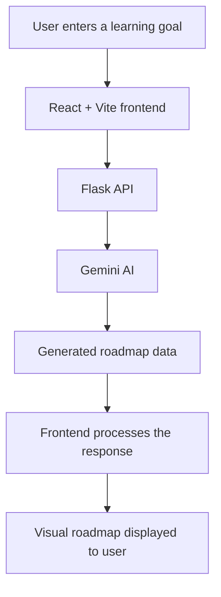

# 🚀 StudySync — AI-Powered Learning Roadmap Generator

<p align="center">
  <strong>Turn your career goals into a structured learning journey.</strong>
</p>

<p align="center">
  An AI-powered study planning application that helps learners generate personalized learning roadmaps based on their target roles and goals.
</p>

<p align="center">
  
  
  
  
  
</p>

---

## 📌 About the Project

**StudySync** is a learning roadmap generator built to help students and aspiring developers organize their learning around a career goal.

Instead of figuring out what to learn next, users can enter a target role, such as *AI Engineer*, and generate a structured roadmap with the help of Google's Gemini AI.

The project combines a React frontend with a Python Flask backend to connect the user interface to the AI-powered roadmap generation service.

## ✨ Key Features

- 🤖 **AI-powered roadmap generation** — uses Google Gemini to generate learning roadmaps.
- 🎯 **Career-oriented learning** — start with a target role or learning goal.
- 🗺️ **Visual learning roadmap** — present learning steps as a connected roadmap.
- 🔀 **Structured learning flow** — organize milestones and relationships between learning steps where supported by the generated roadmap.
- ⚡ **React and Vite frontend** — provides a modern development experience.
- 🔌 **Flask API integration** — connects frontend requests with backend AI processing.
- 🔐 **Environment-based API configuration** — keeps the Gemini API key in a local environment file rather than hardcoding it in source code.

## 🛠️ Tech Stack

| Technology | Purpose |
|---|---|
| React | Frontend user interface |
| Vite | Frontend development server and build tooling |
| JavaScript | Frontend logic and interactions |
| Python | Backend application logic |
| Flask | Backend API |
| Google Gemini API | AI-powered roadmap generation |
| JSON | Data exchange between frontend and backend |
| Git and GitHub | Version control and collaboration |

## 🏗️ How It Works



1. **Input:** The user enters a career role or learning goal.
2. **Request:** The frontend sends a request to the Flask backend.
3. **AI processing:** The backend sends the relevant prompt to Gemini.
4. **Response:** The backend returns the generated roadmap data.
5. **Visualization:** The frontend displays the roadmap to the user.

## 📂 Project Structure

The repository includes a React/Vite frontend and a Flask backend. The key files include:

```text
Study-app/
├── src/                 # React frontend source
├── public/              # Public frontend assets, if present
├── app.py               # Flask backend
├── requirements.txt     # Python dependencies
├── package.json         # Node.js dependencies and scripts
├── .env                 # Local API configuration (not committed)
├── .gitignore           # Git ignore rules
└── README.md            # Project documentation
```

*Note: The exact contents of `src/` and other folders may vary as the project evolves.*

## ⚙️ Getting Started

Follow these steps to run StudySync locally.

### Prerequisites

Install the following tools before starting:

- [Git](https://git-scm.com/)
- [Node.js and npm](https://nodejs.org/)
- [Python](https://www.python.org/)
- A Google Gemini API key from [Google AI Studio](https://aistudio.google.com/)

### 1. Clone the Repository

```bash
git clone https://github.com/ankurkumar02468ak-eng/Study-app.git
cd Study-app
```

### 2. Install Frontend Dependencies

```bash
npm install
```

If PowerShell blocks the `npm` command on Windows, try:

```powershell
npm.cmd install
```

### 3. Install Backend Dependencies

```bash
py -m pip install -r requirements.txt
```

If your system uses `python` instead of the Windows `py` launcher, use the appropriate Python command for your installation.

### 4. Configure the Gemini API Key

Create a `.env` file in the project root and add your Gemini API key using the **environment variable name read by `app.py`**.

For example, if the backend reads `GOOGLE_API_KEY`:

```env
GOOGLE_API_KEY=your_gemini_api_key_here
```

Replace the placeholder with your own key. Do not commit `.env` or expose your API key in screenshots, source code, or public repositories.

### 5. Start the Backend

Open a terminal in the project root and run:

```powershell
py app.py
```

The Flask backend runs at:

```text
http://127.0.0.1:3001
```

Keep this terminal running.

### 6. Start the Frontend

Open a **second terminal** in the project root and run:

```powershell
npm.cmd run dev
```

Open the local URL printed by Vite, typically:

```text
http://localhost:5173/
```

Keep both terminals running while using the application.

## 🧪 Using the Application

1. Open the frontend in your browser.
2. Enter a target career role, such as `AI Engineer`.
3. Request a roadmap.
4. Wait for the backend to process the request.
5. Explore the generated roadmap in the interface.

The generated content depends on the AI response and the application's current implementation.

## 🔌 API Integration

The frontend communicates with the Flask backend through an HTTP API.

| Endpoint | Method | Purpose |
|---|---|---|
| `/api/generate-roadmap` | `POST` | Requests AI-generated roadmap content |

The endpoint is served by the local Flask backend at `http://127.0.0.1:3001` during development.

## 🔒 Security Notes

- Store API credentials in `.env`.
- Ensure `.env` is excluded by `.gitignore`.
- Never commit real API keys to GitHub.
- Keep API requests that require secret credentials on the backend.
- Configure API usage limits and handle failed AI requests appropriately.

## 🚧 Future Improvements

Potential areas for further development include:

- 📊 Learning progress tracking
- 💾 Saving and revisiting generated roadmaps
- 🎓 Project recommendations for each learning milestone
- 🔄 Editing and regenerating individual roadmap sections
- 👤 User accounts and personalized learning history
- 🚀 Deployment with secure environment-variable configuration

These are potential enhancements, not claims that all of them are currently implemented.

## 🤝 Contributing

Contributions, suggestions, and bug reports are welcome.

1. Fork the repository.
2. Create a feature branch.
3. Make your changes and test them.
4. Commit your changes with a descriptive message.
5. Open a pull request.

## 👨‍💻 Maintainer

**Ankur Kumar**

B.Tech Computer Science and Engineering student interested in AI/ML, web development, and building practical software projects.

- GitHub: [@ankurkumar02468ak-eng](https://github.com/ankurkumar02468ak-eng)

## 📄 License

Check the repository for an existing `LICENSE` file before redistributing or reusing this project. If no license is present, the repository's reuse terms have not been explicitly defined.

---

<p align="center">
  <strong>Built to make learning more structured, focused, and goal-oriented. 🚀</strong>
</p>